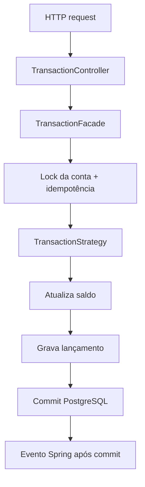

<div align="center">

# 💳 Pulso Banking API
### Operações financeiras • Persistência transacional • Design Patterns

  

</div>

## 🎯 Sobre

API bancária didática criada para praticar decisões comuns em sistemas financeiros: movimentar saldo, evitar operações duplicadas e manter o extrato consistente com o estado da conta.

Depósitos e saques usam estratégias próprias. Cada operação atualiza o saldo e grava seu lançamento no PostgreSQL dentro da mesma transação. Uma chave de idempotência protege contra repetição acidental de uma requisição.

## ✨ O que a API oferece

- Consulta de conta e saldo.
- Depósito e saque com valores monetários em `BigDecimal` e precisão de centavos.
- Histórico persistido de movimentações com identificador e data.
- Idempotência por conta e pela chave `Idempotency-Key`.
- Erros claros para conta inexistente, valor inválido, saldo insuficiente e conflito de chave.

## 🏗️ Fluxo de uma operação



## 🧩 Padrões e decisões

| Conceito | Onde aparece | Papel |
|---|---|---|
| Strategy | `DepositStrategy`, `WithdrawalStrategy` | Mantém as regras de cada operação separadas. |
| Facade | `TransactionFacade` | Coordena validação, idempotência, saldo, histórico e publicação do evento. |
| Repository | `AccountRepository`, `TransactionRepository` | Separa os serviços das implementações JPA e do PostgreSQL. |
| Observer / eventos do Spring | `TransactionCompleted`, `TransactionCompletedListener` | Emite um evento depois do commit para consumidores complementares. |
| Injeção de dependências | Beans do Spring | Conecta as implementações no container. |

## 🔒 Idempotência e consistência

O cliente envia uma chave `Idempotency-Key` por operação. Se repetir a mesma chave para a mesma conta e os mesmos dados, a API devolve o resultado original sem movimentar o saldo de novo. Se reutilizar a chave com outra operação ou valor, recebe HTTP `409 Conflict`.

A conta é bloqueada para atualização durante o processamento. A alteração do saldo e a inserção do lançamento são feitas na mesma transação PostgreSQL: se a gravação do histórico falhar, a atualização do saldo também é revertida. Uma restrição única no banco reforça a idempotência mesmo diante de concorrência.

O evento do Spring é disparado após o commit. O histórico é consultado diretamente no PostgreSQL, não depende do listener para ser gravado. Esta versão ainda não usa uma fila durável como Kafka ou RabbitMQ.

## ⚙️ Como executar

Requisitos: JDK 21, Maven e Docker com Compose.

Na pasta do projeto, suba o PostgreSQL:

```bash
docker compose up -d db
```

Depois inicie a API:

```bash
mvn spring-boot:run
```

A aplicação inicia em `http://localhost:8080`. O Flyway cria as tabelas e inclui as contas de demonstração `ACC-1001` (R$ 1.000,00) e `ACC-1002` (R$ 250,00).

As configurações padrão do banco local são `pulso` / `pulso`. É possível sobrescrevê-las com `DB_URL`, `DB_USERNAME` e `DB_PASSWORD`. Para desligar o banco mantendo os dados, use `docker compose down`. Apagar o volume com `docker compose down -v` remove os dados locais.

## 🔌 Exemplos de uso

Consultar uma conta:

```bash
curl http://localhost:8080/api/accounts/ACC-1001
```

Depositar. Reutilize a mesma chave somente ao repetir esta mesma requisição:

```bash
curl -X POST http://localhost:8080/api/accounts/ACC-1001/transactions \
  -H "Content-Type: application/json" \
  -H "Idempotency-Key: deposito-001" \
  -d '{"type":"DEPOSIT","amount":150.00}'
```

Sacar:

```bash
curl -X POST http://localhost:8080/api/accounts/ACC-1001/transactions \
  -H "Content-Type: application/json" \
  -H "Idempotency-Key: saque-001" \
  -d '{"type":"WITHDRAWAL","amount":50.00}'
```

Consultar o histórico persistido:

```bash
curl http://localhost:8080/api/accounts/ACC-1001/transactions
```

Os tipos aceitos são `DEPOSIT` e `WITHDRAWAL`. Uma operação concluída retorna `transactionId`, `accountId`, `type`, `amount`, `balanceAfter` e `createdAt`.

## 🧪 Testes e integração contínua

A suíte cobre regras de saldo, precisão monetária, endpoints, idempotência, conflito de chave e consistência entre saldo e histórico. O GitHub Actions sobe PostgreSQL 16 e executa `mvn verify` em alterações no projeto e em pull requests.

Para executar localmente, com o banco iniciado:

```bash
mvn test
```

## ⚠️ Escopo

Este é um projeto didático, não um sistema bancário pronto para produção. Ele não implementa autenticação, autorização, transferências, integração com meios de pagamento, mensageria durável ou políticas operacionais de um banco real.

## 📚 Contexto

Projeto de portfólio feito para o desafio **Design Patterns com Java: Dos Clássicos (GoF) ao Spring Framework**, da DIO. A proposta foi criar uma API própria em Spring Boot e aplicar padrões a um fluxo financeiro simples.

Referências do laboratório: [Java Puro](https://github.com/digitalinnovationone/lab-padroes-projeto-java) · [Spring](https://github.com/digitalinnovationone/lab-padroes-projeto-spring).

[← Voltar aos outros exercícios Java do repositório](../README.md)
