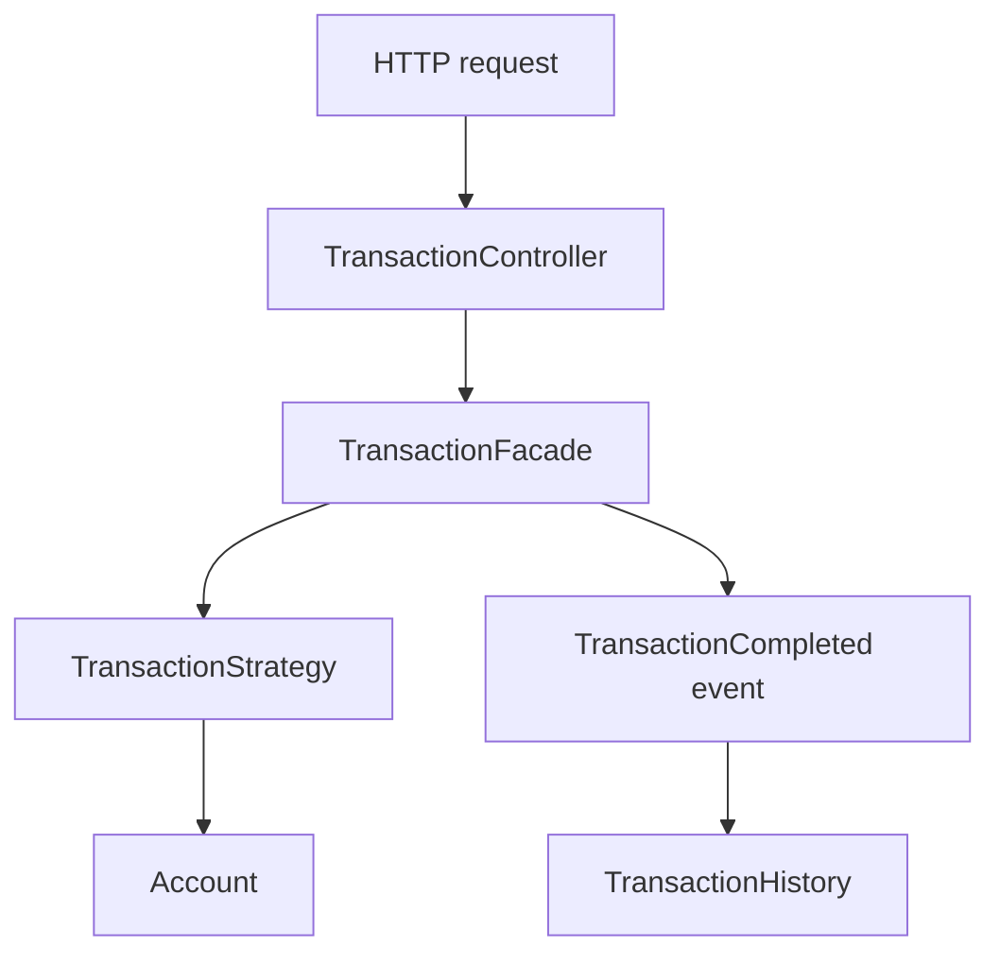

<div align="center">

# 💳 Pulso Banking API
### Operações financeiras • Event-driven • Design Patterns

  

</div>

## 🎯 Sobre

Uma API pequena para estudar decisões que aparecem em sistemas financeiros: movimentar saldo com segurança, manter um histórico legível e deixar cada operação fácil de estender.

O foco do projeto é mostrar como os padrões de projeto podem resolver problemas concretos. Depósito e saque seguem caminhos próprios, mas compartilham a mesma entrada e o mesmo contrato HTTP. Depois de uma operação bem-sucedida, a aplicação publica um evento e registra a movimentação no histórico.

## ✨ O que dá para fazer

- Consultar o saldo de uma conta.
- Depositar e sacar usando valores `BigDecimal`.
- Consultar o histórico com identificador e horário de cada movimentação.
- Receber erros HTTP consistentes para conta inexistente, valor inválido ou saldo insuficiente.

## 🏗️ Como uma operação percorre a aplicação



A estratégia altera o saldo no domínio. Só depois da operação concluída a fachada publica o evento; o listener atualiza o histórico. Assim, a API não precisa conhecer os detalhes de como o histórico é armazenado.

## 🧩 Padrões e escolhas

| Conceito | Onde aparece | Por que está aqui |
|---|---|---|
| Strategy | `DepositStrategy`, `WithdrawalStrategy` | Cada tipo de operação tem sua regra sem ramificações espalhadas pela API. |
| Facade | `TransactionFacade` | Coordena validação, busca da conta, execução e publicação do evento. |
| Repository | `AccountRepository` | Mantém a regra de negócio separada do armazenamento. |
| Observer / eventos do Spring | `TransactionCompleted`, `TransactionHistory` | O histórico reage à operação concluída sem ficar acoplado à estratégia. |
| Injeção de dependências | Beans do Spring | As implementações são conectadas pelo container. |

## ⚙️ Como executar

Requisitos: JDK 21 e Maven.

```bash
git clone https://github.com/WalterMatheusgg/oficina-java.git
cd oficina-java/design-patterns-bank-api
mvn spring-boot:run
```

A aplicação inicia em `http://localhost:8080`. As contas de demonstração são `ACC-1001` (R$ 1.000,00) e `ACC-1002` (R$ 250,00).

## 🔌 Exemplos de uso

Consultar uma conta:

```bash
curl http://localhost:8080/api/accounts/ACC-1001
```

Depositar:

```bash
curl -X POST http://localhost:8080/api/accounts/ACC-1001/transactions \
  -H "Content-Type: application/json" \
  -d '{"type":"DEPOSIT","amount":150.00}'
```

Sacar:

```bash
curl -X POST http://localhost:8080/api/accounts/ACC-1001/transactions \
  -H "Content-Type: application/json" \
  -d '{"type":"WITHDRAWAL","amount":50.00}'
```

Consultar o histórico da conta:

```bash
curl http://localhost:8080/api/accounts/ACC-1001/transactions
```

Uma movimentação concluída retorna `transactionId`, `accountId`, `type`, `amount`, `balanceAfter` e `createdAt`. Os tipos aceitos são `DEPOSIT` e `WITHDRAWAL`.

## ⚠️ Limites desta versão

O armazenamento de contas e histórico é em memória. Reiniciar a aplicação restaura os saldos de exemplo e apaga as movimentações. O evento é publicado dentro do processo e tratado de forma síncrona; isso ajuda a estudar o fluxo, mas não substitui uma fila durável quando a entrega do evento precisa sobreviver a falhas.

A versão também não implementa autenticação, autorização ou persistência real. Esses seriam próximos passos antes de pensar em uso fora de um ambiente de estudo.

## 🛠️ Tecnologias

Java 21 · Spring Boot · Spring Web · Maven

## 📚 Contexto

Projeto de portfólio desenvolvido durante os estudos de Java e Spring, a partir do desafio de Design Patterns da DIO. A ideia foi conectar os padrões a um fluxo familiar de uma API financeira, sem esconder as simplificações da implementação.

[← Voltar aos outros exercícios Java do repositório](../README.md)
